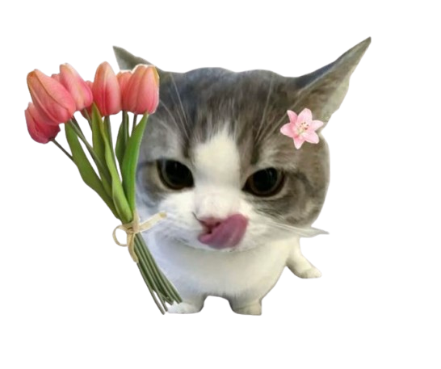

# 👑 Princess Day Website — Romantic Interactive Surprise 💕

<div align="center">



### 💖 A magical, interactive romantic website crafted to make your princess feel like the most special girl in the universe! ✨

[](https://nextjs.org/)
[](https://www.typescriptlang.org/)
[](https://tailwindcss.com/)
[](https://www.framer.com/motion/)

---

### 🌐 **[👉 CLICK HERE TO VIEW LIVE WEBSITE 👈](https://divyanshuuuuuuuuu.github.io/princess-day-website/)**

[](https://divyanshuuuuuuuuu.github.io/princess-day-website/)

*(Live website is up and running — experience the full romantic surprise directly on your phone or PC without downloading anything!)*

---

</div>

## 🌟 Magical Interactive Features

This website is not just a letter; it is an unforgettable romantic digital journey packed with smooth animations, sweet surprises, music, and games:

1. **💌 Heartfelt Envelope & Love Letter**:
   - Elegant pastel greeting card that reveals an authentic, handwritten-style love letter for your special princess.
   - Interactive confetti bursts and playful animations.

2. **🎯 Princess Whac-A-Mole Mini-Game**:
   - A playful, interactive mini-game with cute pop-up moles, real-time score counter, animated hearts, and celebratory sounds!
   - Win the mini-game (10 points) to unlock the grand reward: **"1 Free Pappi 💋 — DM me cutie hehehe"** with a special claim button!

3. **🌻 Sunset Sunflower Meadow & Serenade**:
   - A cinematic golden sunset with realistic wind-swayed blooming sunflowers.
   - Two cute geometric figures (blue & pink) sitting side-by-side on the hill watching the sunset together holding hands.
   - Automatic background serenade with the soothing romantic song ***Khaab* by Akhil** (starts at the sweetest melody at 2:00 and loops automatically).

4. **🎵 Curated Love Playlist Carousel**:
   - An interactive music player featuring romantic love tracks with audio playback, animated sound waves, and album covers.

5. **🎴 3D Memory Flip Cards**:
   - Interactive 3D cards that flip over with personalized photos, warm compliments, and sweet secret messages on the back.

6. **💋 Virtual Kiss & Sparkle Particles**:
   - Floating kiss particles (`💋`) and hearts rise across the screen on every interaction.
   - Sealed letter completion screen sealing your love forever.

---

## 📱 Want a Custom Website for Your Princess? 💖

> **Looking for a personalized romantic website for your girlfriend, wife, or crush?**
>
> Whether it's for **National Princess Day**, **her Birthday**, **your Anniversary**, **Valentine's Day**, or a **Marriage Proposal**, I can build a completely custom, uniquely animated website tailored with your personal photos, your favorite songs, your own inside jokes, and special love messages!

### 📞 Contact Me Directly:
- **Phone / WhatsApp**: **`+91 9303044289`** 📲
- **Customization turnaround**: Quick, beautiful, and tailored just for her!

---

## 🚀 Quick Start (Run Locally)

### Prerequisites
- Node.js 18+ installed on your computer.

### Installation

```bash
# 1. Clone this repository
git clone https://github.com/divyanshuuuuuuuuu/princess-day-website.git

# 2. Enter directory
cd princess-day-website

# 3. Install dependencies
npm install

# 4. Start local development server
npm run dev
```

Open your browser and navigate to **[http://localhost:3000](http://localhost:3000)** (or **[http://localhost:8000](http://localhost:8000)**).

---

## 🎨 How to Customize for Your Princess

You can easily adapt this project for your own girlfriend/wife:

### 1. Change Her Name & Main Message
Open `components/MessageCard.tsx` and `data/message.ts`:
- Change the name to your princess's name.
- Customize the love letter with your own heartfelt words.

### 2. Update Flip Cards & Photos
Open `components/FlipCards.tsx`:
- Replace `/assets/pic1.png`, `/assets/pic2.png`, and `/assets/pic3.png` with your photos in `public/assets/`.
- Change the card messages to your favorite memories with her.

### 3. Change Songs & Audio
- Add your favorite romantic MP3 tracks into `public/assets/`.
- Update `components/SunflowerGarden.tsx` and `components/Playlist.tsx` to play your special couple songs!

---

## 🚢 Free 1-Click Deployment

Deploy your website for free in under 2 minutes with zero setup:

### Deploy to Vercel (Recommended)
[](https://vercel.com/new/clone?repository-url=https://github.com/divyanshuuuuuuuuu/princess-day-website)

Click the button above, sign in with your GitHub account, and Vercel will automatically build and give you a free live URL (e.g., `https://princess-day-website.vercel.app`)!

### Deploy to Netlify
[](https://app.netlify.com/start/deploy?repository=https://github.com/divyanshuuuuuuuuu/princess-day-website)

Click the button above to deploy on Netlify with the pre-configured `netlify.toml` file.

---

## 🛠️ Tech Stack

- **Framework**: [Next.js 14](https://nextjs.org/) (React 18)
- **Language**: [TypeScript](https://www.typescriptlang.org/)
- **Styling**: [Tailwind CSS](https://tailwindcss.com/)
- **Animations**: [Framer Motion](https://www.framer.com/motion/)
- **Icons & Effects**: Canvas Confetti, SVG Illustrations

---

## ❓ Frequently Asked Questions (FAQ)

### What is the Princess Day Website?
The **Princess Day Website** (`princess-day-website`) is a free, open-source romantic web application created to celebrate National Princess Day, birthdays, anniversaries, and special moments with your girlfriend, partner, or wife.

### Can I change the names, photos, and songs?
Yes! The codebase is completely customizable. You can change her name, add your personal photos to the 3D flip cards, customize the love letter, and add your favorite romantic songs with just a few clicks.

### How can I get a customized website made for me?
If you'd like a bespoke website created with customized animations, special themes, and personal memories, feel free to reach out directly via call or WhatsApp at **[+91 9303044289](tel:+919303044289)**.

---

## 🔍 Search & Keywords

`princess-day-website` • `princess day website` • `national princess day website` • `romantic website for girlfriend` • `interactive love letter website` • `whac a mole princess game` • `sunflower sunset meadow website` • `gift for girlfriend github` • `romantic nextjs template`

---

## 📄 License & Credits

Made with 💕 by **Divyanshu** for all the princesses in the world. Feel free to use and star ⭐ this repo!
If this project helped you make someone smile, don't forget to give it a star on GitHub! 🌟
Repository: **[https://github.com/divyanshuuuuuuuuu/princess-day-website](https://github.com/divyanshuuuuuuuuu/princess-day-website)**
